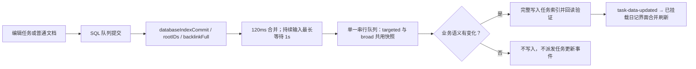
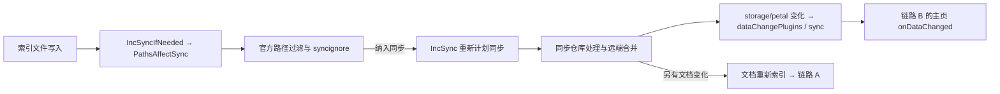

# 任务索引读写与同步审计

日期：2026-10-19。审查基线：`6c8868c4efb4ea04b55161cc7121b00b951617d7`。
测试仅使用内存 API fixture 和合成任务；未读取用户 task-index.json、日记或聊天数据。

## 结论

| 问题 | 结论与边界 |
| --- | --- |
| 是否存在无限反馈循环？ | **未发现可证实的无限事件循环**。数据库提交和插件数据通知是不同命令；主页覆盖的 onDataChanged 不重建主页，也不直接刷新任务索引。真实多端事件频率仍待验证。 |
| task-index.json 是否整文件写入？ | 是，路径仍是 `/data/storage/petal/siyuan-homepage/task-index.json`。业务语义变化或确认清理失效任务后整写；未改变 schema/version。 |
| 3.57 MB 索引是否放大同步成本？ | 会增加序列化、文件写入和同步仓库处理的输入量；是否计划同步取决于官方路径过滤与 syncignore。完整文件字节数**不等于云端实际传输字节数**。 |
| 是否存在无内容变化的保存？ | 修复前 prune 无失效任务时，仅修改 lastVerifiedAt 也整写。修复后此路径零写入。缺失 updated 不再每次生成当前时间；SQL 增量刷新保留已有 indexedAt。 |
| 是否存在重复 databaseIndexCommit？ | 内核多次提交可以涉及同一根文档，并不表示任务变化。20 次同根模拟事件只查询一次。刷新中的新事件留给尾随批次。 |
| 是否存在读取失败变空索引的风险？ | 修复前通用读取 catch 返回 []，修改任务可覆盖未知基线。现在任务分支只认可明确 404 为缺失，异常、权限错误、空/损坏内容、错误版本和非法条目拒绝写入。 |
| Notebrain 是否类似？ | 会话正文已分文件且有内容相等判断；每次保存事务仍递增聊天索引 revision 并整写 index.json。本轮只读审计，未修改聊天资产。 |
| 是否立即拆分任务索引？ | 本轮不拆分。先用诊断采集真实频率；若分散的小修改仍持续整写大文件，再单独设计可回滚、跨设备兼容的分片方案。 |

## 官方事件链

以下依据固定正式 tag v3.8.7；另核对了 v3.8.6 的数据库提交、文件写入和插件通知定义，相关边界一致。当前本地 Kernel 的版本未能实机确认。

### A：任务块编辑

`rootIDs` 是数据库操作涉及的根文档集合，不是任务变更清单；普通正文、引用更新也可进入 targeted。
`backlinkFull` 表示无法仅用根集合覆盖的较大范围变更，例如删除目录/笔记本、缺少根信息；不是“任务索引必须重建”。另有文档路径刷新发送 broad 通知。
依据：[SQL queue.go](https://github.com/siyuan-note/siyuan/blob/v3.8.7/kernel/sql/queue.go)、[hpath_refresh.go](https://github.com/siyuan-note/siyuan/blob/v3.8.7/kernel/model/hpath_refresh.go)。

### B：本地插件存储通知

宿主请求带应用标识时，排除发起客户端，通知连接同一 Kernel 的其他前端；没有标识时可能广播给全部前端。
数据通知并不等于插件代码重载：主页覆盖了 onDataChanged，生命周期协调器走该钩子。默认未覆盖此钩子的其他插件可以走重载。
依据：[file.go](https://github.com/siyuan-note/siyuan/blob/v3.8.7/kernel/api/file.go)、[push_reload.go](https://github.com/siyuan-note/siyuan/blob/v3.8.7/kernel/model/push_reload.go)、[fetchWithAppId.ts](https://github.com/siyuan-note/siyuan/blob/v3.8.7/app/src/util/fetchWithAppId.ts)、[loader.ts](https://github.com/siyuan-note/siyuan/blob/v3.8.7/app/src/plugin/loader.ts)、[lifecycle.ts](https://github.com/siyuan-note/siyuan/blob/v3.8.7/app/src/plugin/lifecycle.ts)。

本仓库 `src/index.ts` 的 onDataChanged 只接受 sync / overwrite / 未提供原因，调度会员验证、共享设置通知及共享 Runtime 更新。后者按设置键同步菜单、Dock、工具栏等，未调用任务索引刷新、设备视图重建或全部组件重挂载。
已有 shared-runtime-refresh verifier 执行真实方法，覆盖无变化设置、异常和销毁场景。

### C：跨设备同步

插件存储默认属于可同步的数据路径；用户忽略规则、文件系统过滤会改变结果。本轮没有读取或修改用户同步规则。
每次成功文件写入都会检查是否影响同步，符合条件时重新计划；多次计划不等于同次数的实际云端上传。
仅同步插件 JSON 不会直接作为任务文档 SQL 提交；若同批还有 `.sy` 文档变化，则可以重新进入 A，语义无变化时不会再次写任务索引。
依据：[sync_path.go](https://github.com/siyuan-note/siyuan/blob/v3.8.7/kernel/model/sync_path.go)、[sync_ignore.go](https://github.com/siyuan-note/siyuan/blob/v3.8.7/kernel/model/sync_ignore.go)、[repository.go](https://github.com/siyuan-note/siyuan/blob/v3.8.7/kernel/model/repository.go)。没有网络抓包或双设备测试，不能量化云端流量。

## 确认的开销和修复

- targeted 原先存在性检查读一次、保护旧条目读一次、merge 再读一次；现在一次串行快照完成查询、保护、合并。
- targeted 与 broad 同批共用快照、逐块校验结果、最终写入。SQL 已确认的任务无需在同批 broad 再读块详情；unknown 校验结果同批复用，绝不当作删除。
- 去掉 lastVerifiedAt 单独持久化；该字段没有业务读取方。保留已存在字段，不迁移文件。
- merge 复用 Map，未触碰条目以对象身份跳过比较；有变化的条目仍比较完成状态、正文、日期、路径、属性和项目关系。不再逐项 JSON.stringify 后又排序并整体 stringify。
- 所有任务修改继续进入 taskIndexMutationTail。SQL 也在队列内部查询，避免排队前的旧 SQL 结果越过已确认业务修改。
- 使用已有 checked 文件/SQL API，任务写入回读验证。受控 manual-index SQL 入口同样检查 API 错误，不能以成功空数组覆盖手动重建结果；没有改变其安全 SELECT 范围。
- 卸载代次在队列入口、读取后、查询后、校验批次和提交前检查。**已经发送给 Kernel 的写请求无法撤回**；会继续完成验证，串行尾不会因卸载而丢弃。这里没有跨设备 CAS，不能声称解决同时编辑时的所有冲突。
- 保留 120ms 防抖，补 1s 最大等待，防止持续提交无限延迟。慢 I/O/串行前序操作仍会延长实际完成时间。

## 合成基准

生产模块经 esbuild 加载，真实 src/api.ts 连接内存 Kernel port。4500 条合成任务，输入 **3,927,458 B**，没有使用外部用户约 3.57 MB 的原文件。
写入后体积略大来自现有规范化补齐字段；容量是 UTF-8 Blob 字节数，不是文件系统、云同步或客户端实测。

| 操作 | 基线完整读取 | 优化后完整读取 | 基线写入 | 优化后写入 | 基线写入字节 | 优化后写入字节 |
| --- | ---: | ---: | ---: | ---: | ---: | ---: |
| targeted，内容未变 | 3 | 1 | 0 | 0 | 0 | 0 |
| broad，全部任务有效 | 2 | 1 | 1 | 0 | 4,161,468 | 0 |
| targeted + broad，一条完成状态变化 | 5 | 2 | 2 | 1 | 8,457,934 | 4,111,967 |

优化后“2 次读取”包含一次必要的写后回读。每个变更批次仅作一次合并业务比较；写后另作完整性比较。
一次运行的耗时样本：基线 72.6 / 101.7 / 257.6 ms；优化后 42.5 / 46.4 / 83.4 ms。它们是不同运行的 CPU/内存 fixture 观测，**不作为稳定加速比例或真实客户端延迟结论**；脚本每次重新输出时间。

可重跑：`pnpm verify:task-index-sync-performance`；基线：`node scripts/verify-task-index-sync-performance.mjs --baseline`，后者只读 git show 固定基线的三个生产源文件。

### 操作计数（优化后模拟，未挂载前台 UI）

| 输入场景 | commit | targeted | broad | 完整读 | 写 | 写入总字节 | task-data-updated |
| --- | ---: | ---: | ---: | ---: | ---: | ---: | ---: |
| 完成一条任务 | 1 | 1 | 0 | 2 | 1 | 4,111,967 | 1 |
| 正文增加一个汉字 | 1 | 1 | 0 | 2 | 1 | 4,111,971 | 1 |
| 修改项目属性 | 1 | 1 | 0 | 2 | 1 | 4,112,165 | 1 |
| 同窗连续完成十条 | 10 | 1 | 0 | 2 | 1 | 4,111,958 | 1 |
| 十次分批完成 | 10 | 10 | 0 | 20 | 10 | 41,119,625 | 10 |
| 无任务的普通文档修改 | 1 | 1 | 0 | 1 | 0 | 0 | 0 |
| 仅启动任务 Runtime | 0 | 0 | 0 | 0 | 0 | 0 | 0 |
| 仅插件数据同步通知 | 0 | 0 | 0 | 0 | 0 | 0 | 0 |
| 同一日记仅改普通记录 | 1 | 1 | 0 | 1 | 0 | 0 | 0 |

这些是明确注入的事件数量，**不是测得 Kernel 编辑一次必定只发一次事件**。完整工作区初次恢复还会走初始化、最近文档刷新、前台读取，不能用 Runtime 启动零读代表整个主页零开销。前台消费也可能增加索引读取和逐块校验。
十次分散、已确认的修改仍需十次写入；本轮未用延迟缓存牺牲即时持久化，也未声称全部交互合成一次写入。

对于大小 S≈3.57 MB 的文件，单批真实变动仍大致需要读取/解析 S、序列化并写入 S、回读/解析 S（约 3S 文件负载，未计字段补齐和 API 协议）。这是格式未拆分时保留的 O(N) 成本。

## 默认关闭的诊断

在当前主页插件实例上可调用 `plugin.taskIndexDiagnostics.enable(true)`、`.snapshot()`、`.reset()`、`.enable(false)`。
这里的 plugin 指调试器中实际插件实例；没有增加全局设置、磁盘日志或新的 UI 面板。卸载移除入口并关闭采集。

固定 14 个数字：commit、去重前根数量、批次去重后根数量、targeted、broad、完整读取、读取解析毫秒、合并比较毫秒、实际成功写入、写入字节、写入毫秒、无变化跳写、派发事件、前台刷新。无正文、路径、ID、聊天或凭据。
前台计数在现有两处日记界面的合并回调真正执行时累加，不按收到的事件数累加；生产回调经 Svelte AST 提取执行验证。

## Notebrain 独立只读审计

检查了 chat-session-store.ts、chat-session-facade.ts、notebrain-storage-keys.ts、notebrain-plugin-storage.ts、storage-write-queue.ts、notebrain-workspace-fs.ts，以及 kb-session-store.ts 的保存调度。

会话索引是 `notebrain/chat/index.json`；正文是 `notebrain/chat/sessions/{id}.json`，通过插件 saveData 整文件写入各自文件并回读。相同会话 payload 会跳过正文保存，但 facade 的保存事务仍构造 revision+1 的完整索引并写回。
调度已有默认 800ms 防抖、串行事务和尾随保存；因此不能把流式输出的每个 token 等同一次落盘。会话条目数量增加时，遍历会话/读取正文/索引写入的成本仍值得单独测量。
SDK saveData 最终调用官方 putFile，因此适用相同插件存储通知与同步路径规则。依据：[插件 SDK 实现](https://github.com/siyuan-note/siyuan/blob/v3.8.7/app/src/plugin/index.ts)。
本轮不改变 revision、活动会话、删除墓碑或正文；没有“清理”、重建或迁移聊天数据。无变化事务的索引跳写需要独立验证并发、删除和活动会话语义，留待专门任务。

## 后续边界和验收

本轮没有拆分文件、引入缓存一致性层、修改版本或索引 schema，没有关闭 ws / broad / 同步，没有写真实用户文档、项目、聊天或通知。
仍保留：单文件 O(N) 成本、broad 和前台任务读取中的逐块确认开销、多前端同时编辑的跨实例竞态。源代码中 frontend getFile 依赖 SDK 回调，若底层网络失败不兑现回调，队列可能继续等待；本轮未扩改全局 runtime port 或制造默认空值。

建议先启用有界诊断，观察真实 3.57 MB 索引的批次数、写字节、块 API 时间、前台刷新次数，再决定是否分片。分片收益是缩小变更文件；风险是多文件原子提交、跨端版本兼容、删除传播和失败恢复，必须单独设计且保留回滚。

本地带鉴权请求 `127.0.0.1:6806` 被拒绝连接。未执行真实客户端的空闲观察、编辑/完成/创建任务、关闭主页、同步、重启和双设备十项验收。需要外部复测，mock 通过不代表实机卡顿已经消失。

验证：focused verifier 20 组真实生产函数场景（A–T 分组覆盖、额外畸形响应、写后验证、前台调度），另有 3 组多 MB 基准及 9 组操作计数；API 兼容、强化日记项目索引、共享 Runtime verifier 通过。typecheck、lint、App / Kernel / 完整构建结果见本次交付报告。
